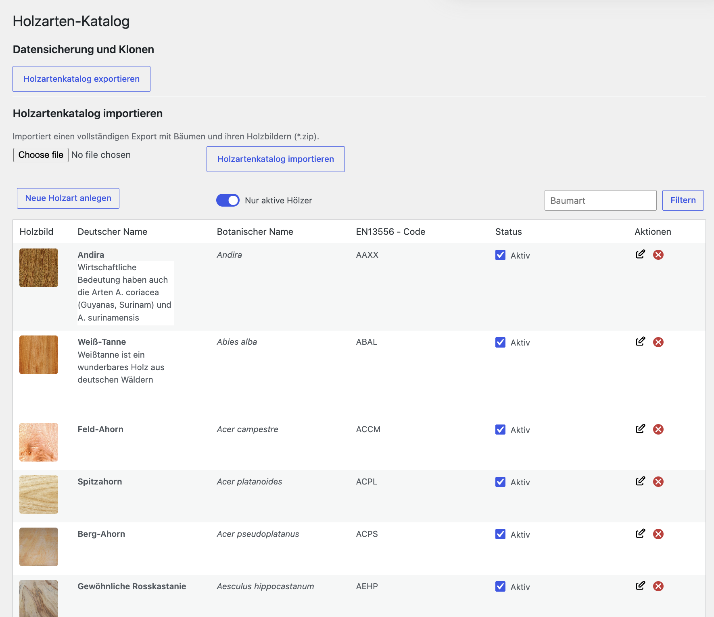
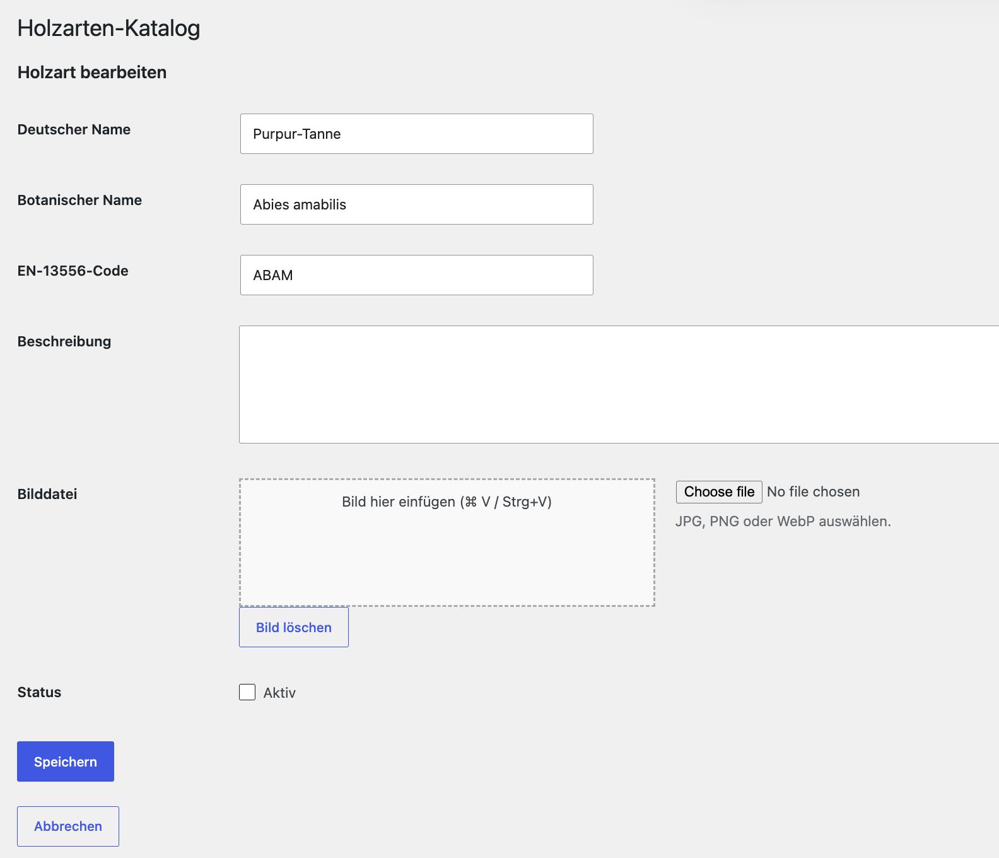
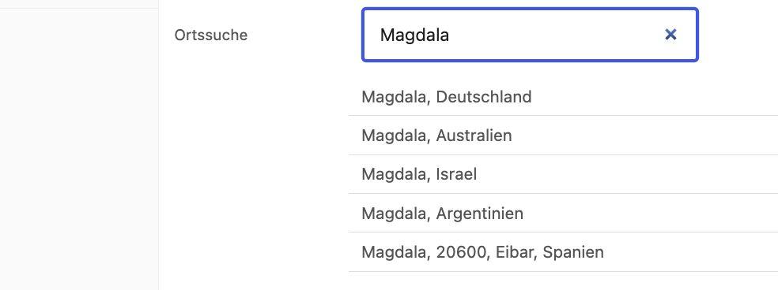
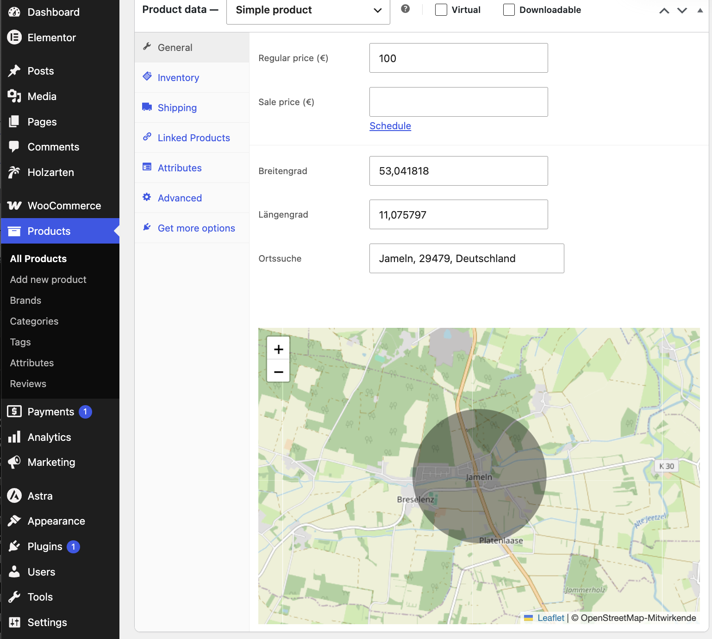

# Holzarten-Katalog

Wordpressmodul, das woocommerce um die Anzeige der Holzarten und ihrer Einschlagorte erweitert

## Datenquellen

- EN 13556 – Holzarten und Handelsbezeichnungen
- Erweiterte Eigenschaften aus Wikipedia

## Datenmodell

Die Holzarten werden anhand ihrer EN-13556-Codes identifiziert.
Die zusammengeführten Daten befinden sich in holzarten_gesamt.json. Daten (Hölzer und Bilder) lassen sich exportieren und wieder in einer anderen Instanz importieren.

## Admin (Verwaltung)

### Liste der Holzarten

Die Liste der Holzarten lässt sich im Menüpunkt HOLZARTEN bearbeiten. Bei Auslieferung des Plugins sind schon viele Holzarten vorbelegt (Quelle: Wikipedia). Bearbeitungsständen lassen sich über EXPORT und IMPORT zwischen Instanzen kopieren.

Bilder lassen sich klassisch mit lokaler Dateiauswahl oder per Pasting über die Zwischenanlage in der Einzelbearbeitung der Hölzer einfügen.

### Holzart

Von der Holzartenliste gelangt man über die Edit-Button zur Detailseite.

Das Holzphoto lässt sich klassisch aus dem lokalen Dateissystem ('Choose File') oder über die Zwischenablage in das Feld einfügen. 

### Holzschlagort

Die Geoposition lässt sich im woocommerce Teil als Attribut komfortabel einpflegen. Eine Ortssuche unterstützt dabei.
Nach Eingabe erscheint eine Liste von möglichen Treffern. 

Nach Auswahl wird die Karte auf den Punkt zentriert und die Position markiert. Die Geodaten können dann dem Produkt zugeordnet werden.

### Zuordnung der Holzarten zu den Produkten
Die Zuordnung erfolgt im Editor des Produktes unter dem Punkt ATTRIBUTES. Dort lässt sich mit dem Dreieck die Liste der aktiven Holzarten aufrufen und die Holzart auswählen.

## Anwendung im Frontend (öffentliche Seite) 

### Liste der Holzarten

Eine bebilderte Liste aller aktiven Holzarten lässt sich mit einem Shortcode im Blockeditor anzeigen:

`[hk_holzarten]`

### Holzart in der Urnenbeschreibung

### Fundstelle des Holzes
Falls eine Geoposition angegeben ist, wird eine Karte unter der Urne angezeigt.

## Installation

Das Plugin lässt sich [hier runterladen](holzarten-katalog-plugin.zip). Danach lässt es sich in Pluginverwaltung von WP einbinden 

